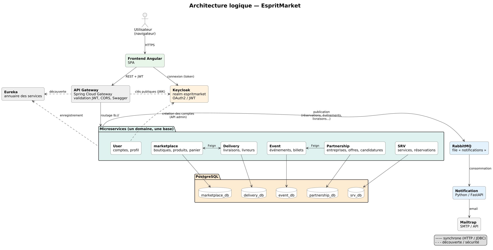
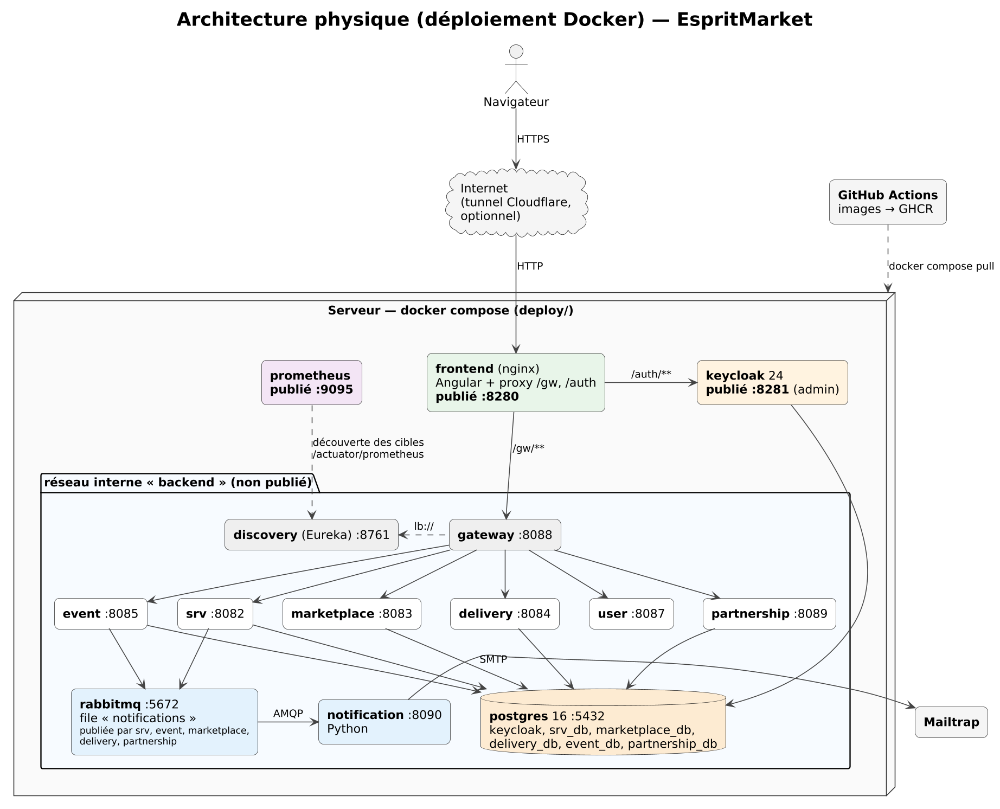

# EspritMarket – Microservices

**Projet : PIDEV 4SE1 (2025–2026)** — ESPRIT
Structure basée sur les workshops **Applications Web Distribuées (AWD)**

Démo en ligne : <https://micro.thesphynx.net>

---

## Présentation du projet

**EspritMarket** est une plateforme dédiée à la communauté ESPRIT, construite en
**architecture microservices** (Spring Boot + Spring Cloud, un service et une base par domaine) :

| Domaine | Ce que l'on peut faire |
|---------|------------------------|
| **Services (SRV)** | Publier une offre de service (prix, durée, mode sur place / à distance, lieu, image), la mettre en pause, la modifier ; rechercher et filtrer les offres ; **réserver** un créneau et suivre la réservation (en attente → acceptée / refusée → terminée, ou annulée), avec notification de l'autre partie |
| **Marketplace** | Boutiques, produits, catégories, panier ; intégration avec la livraison |
| **Livraison (Delivery)** | Livraisons, livreurs, véhicules ; espace d'administration (rôle `ADMIN_DELIVERY`) |
| **Événements (Event)** | Création et gestion d'événements, billets |
| **Partenariats** | Entreprises, offres d'emploi, candidatures, entretiens |
| **Utilisateurs (User)** | Inscription / connexion via **Keycloak** (OAuth2 / JWT), profil |
| **Notifications** | Service Python qui consomme la file RabbitMQ `notifications` et envoie les emails (Mailtrap / SMTP) |

---

## Architecture

### Architecture logique



### Architecture physique (déploiement)



> Sources PlantUML : [`documentation/diag/`](documentation/diag/)

### Flux d'une requête

```
Navigateur ──► frontend (nginx, Angular)
                 ├── /        application Angular
                 ├── /auth/** ──► Keycloak (realm espritmarket)
                 └── /gw/**   ──► gateway :8088 ──lb://──► microservices (via Eureka)
                                                    │
                       microservices ──RabbitMQ (file "notifications")──► Notification ──► email
```

- **Gateway** : point d'entrée unique, valide le JWT Keycloak, CORS, routage `lb://` via Eureka,
  Swagger centralisé.
- **Eureka (discovery)** : registre de services ; tous les services (y compris Notification en Python) s'y enregistrent.
- **Keycloak** : realm `espritmarket` importé depuis [`keycloak/espritmarket-realm.json`](keycloak/espritmarket-realm.json)
  (client public `user-service`, rôle `ADMIN_DELIVERY`).
- **Communication** : synchrone (OpenFeign, marketplace → delivery) et asynchrone (RabbitMQ → Notification).
  Détails : [`documentation/validation-communications.md`](documentation/validation-communications.md),
  [`documentation/communication-marketplace-delivery.md`](documentation/communication-marketplace-delivery.md).

### Services

| Service | Dossier | Port | Préfixes via la gateway |
|---------|---------|------|-------------------------|
| discovery (Eureka) | `backend/discovery/` | 8761 | — |
| gateway | `backend/gateway/` | 8088 | — |
| SRV | `backend/microservices/SRV/` | 8082 | `/srv/**` (offres), `/srv/bookings/**` (réservations) |
| marketplace | `backend/microservices/marketplace/` | 8083 | `/marketplace/**`, `/mic2/shops`, `/mic2/products`, `/mic2/categories`, `/mic2/paniers`, `/mic2/deliveries` |
| Delivery | `backend/microservices/Delivery/` | 8084 | `/delivery/**`, `/api/deliveries`, `/api/deliverers`, `/api/vehicles` |
| Event | `backend/microservices/Event/` | 8085 | `/event/**`, `/mic1/**` |
| User | `backend/microservices/User/` | 8087 | `/user/**` (`/user/me` : profil) |
| Partnership | `backend/microservices/Partnership/` | 8089 | `/patnership/**`, `/api/partnership/**` |
| Notification (Python/FastAPI) | `backend/microservices/Notification/` | 8090 | `/notification/**` |
| frontend (Angular 21) | `frontend/` | 4200 en dev | — |

Les lectures publiques (catalogue des services, boutiques/produits, entreprises et offres d'emploi)
sont accessibles sans connexion ; toutes les écritures demandent un JWT.

### Documentation de l'API

Swagger centralisé sur la gateway : <http://localhost:8088/swagger-ui.html>
(en production : `/swagger-ui.html` sur le domaine du frontend). Un onglet par service
(srv, marketplace, delivery, event, partnership, user).

---

## Technologies

- **Backend** : Java 17, Spring Boot 4, Spring Cloud 2025 (Gateway WebFlux, Eureka, OpenFeign),
  Spring Security OAuth2 Resource Server, Spring Data JPA, springdoc-openapi, Maven
- **Notification** : Python 3, FastAPI, pika (RabbitMQ), envoi via l'API Mailtrap ou SMTP
- **Frontend** : Angular 21 (standalone, signals, sans zone.js, SSR / prérendu), Tailwind CSS
- **Infrastructure** : PostgreSQL 16, RabbitMQ 3, Keycloak 24, Prometheus, Docker Compose,
  GitHub Actions (images publiées sur GHCR), nginx

---

## Démarrage

### Option A — Toute la stack avec Docker (recommandé)

```bash
cd deploy
cp .env.example .env        # adapter les mots de passe (et BIND_IP si besoin)
docker compose pull         # images construites par GitHub Actions
docker compose up -d        # ou : docker compose up -d --build  pour construire localement
```

| URL | Contenu |
|-----|---------|
| <http://127.0.0.1:8280> | Application (sert aussi `/gw` → gateway et `/auth` → Keycloak) |
| <http://127.0.0.1:8281> | Console d'administration Keycloak |
| <http://127.0.0.1:9095> | Prometheus (métriques de tous les services, découverts via Eureka) |

Seuls ces trois ports sont publiés, sur `${BIND_IP}` ; PostgreSQL (une base par service, créées
par [`deploy/postgres/init-databases.sh`](deploy/postgres/init-databases.sh)), RabbitMQ, Eureka,
la gateway et les microservices restent sur le réseau Docker interne.

**Emails (service Notification)** — à configurer dans `deploy/.env`, sinon ils sont seulement loggés :

- **Mailtrap SMTP** (bac à sable) : `SMTP_HOST=sandbox.smtp.mailtrap.io`, `SMTP_PORT=2525`,
  `SMTP_USER` / `SMTP_PASSWORD` (onglet *SMTP* de la boîte), `SMTP_TLS=true`
- **ou API Mailtrap** (prioritaire sur SMTP si renseignée) : `MAILTRAP_API_TOKEN`, `MAILTRAP_INBOX_ID`

Appliquer puis vérifier : `docker compose up -d notification` puis `docker compose logs notification | grep "email mode"`.

**Exposition publique** : pour un tunnel (ex. cloudflared → `http://localhost:8280`), activer
`COMPOSE_FILE=docker-compose.yml:docker-compose.tunnel.yml` dans `.env`. Seul le frontend a besoin
d'être exposé, puisqu'il sert l'application, l'API et Keycloak sur la même origine.

### Option B — Développement local (IDE)

1. **Infrastructure** (Keycloak sur `:8180` avec le realm importé, RabbitMQ sur `:5672`,
   console sur `:15672`, `guest` / `guest`) :

   ```bash
   docker compose up -d        # à la racine du dépôt
   ```

2. **PostgreSQL** sur `localhost:5432` (utilisateur `postgres`, mot de passe `admin` par défaut,
   surchargé par `SPRING_DATASOURCE_PASSWORD`) avec les bases :
   `awd-srv`, `marketplace_db`, `awd-delivery`, `awd-event`, `awd-Partnership`.

3. **Services** — toujours démarrer Eureka en premier, la gateway en dernier :

   ```powershell
   cd backend\discovery;                 .\mvnw.cmd spring-boot:run   # :8761
   cd backend\microservices\SRV;         .\mvnw.cmd spring-boot:run   # :8082
   cd backend\microservices\marketplace; .\mvnw.cmd spring-boot:run   # :8083
   cd backend\microservices\Delivery;    .\mvnw.cmd spring-boot:run   # :8084
   cd backend\microservices\Event;       .\mvnw.cmd spring-boot:run   # :8085
   cd backend\microservices\User;        .\mvnw.cmd spring-boot:run   # :8087
   cd backend\microservices\Partnership; .\mvnw.cmd spring-boot:run   # :8089
   cd backend\microservices\Notification; pip install -r requirements.txt; python app.py   # :8090
   cd backend\gateway;                   .\mvnw.cmd spring-boot:run   # :8088
   ```

   (un terminal par service). Pour les emails en local, copier
   `backend/microservices/Notification/.env.example` en `.env` et le remplir.

4. **Frontend** :

   ```bash
   cd frontend
   npm ci
   npm start                   # http://localhost:4200
   ```

   Le proxy de développement ([`frontend/proxy.conf.json`](frontend/proxy.conf.json)) renvoie
   `/gw` vers la gateway (`:8088`) et `/auth` vers Keycloak (`:8180`), comme nginx en production.

**Vérification** : <http://localhost:8761> doit lister `GATEWAY` et tous les services dans
*Instances currently registered with Eureka*.

---

## Comptes et rôles

- Les comptes se créent depuis la page **Inscription** de l'application (le service User les crée dans Keycloak).
- Le rôle **`ADMIN_DELIVERY`** donne accès à l'administration des livraisons ; il s'attribue dans
  la console Keycloak (realm `espritmarket` → *Users* → *Role mapping*).

---

## Intégration continue

[`.github/workflows/docker-images.yml`](.github/workflows/docker-images.yml) construit l'image Docker
de chaque service à chaque pull request, et les publie sur GHCR (`ghcr.io/<owner>/awd-espritmarket-<service>`)
à chaque push sur `main`.

---

## Structure du dépôt

```
backend/
  discovery/            Eureka Server
  gateway/              Spring Cloud Gateway (sécurité JWT, routes, Swagger centralisé)
  microservices/        SRV, marketplace, Delivery, Event, Partnership, User, Notification
deploy/                 Docker Compose de production, .env.example, init PostgreSQL, Prometheus
documentation/          diagrammes d'architecture et notes de communication inter-services
frontend/               application Angular (+ nginx.conf et Dockerfile de production)
keycloak/               realm espritmarket importé au démarrage de Keycloak
docker-compose.yml      infrastructure de développement local (Keycloak + RabbitMQ)
```
