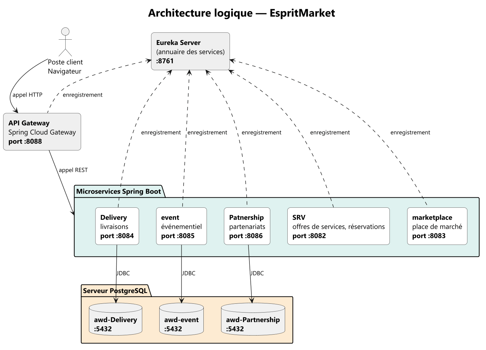
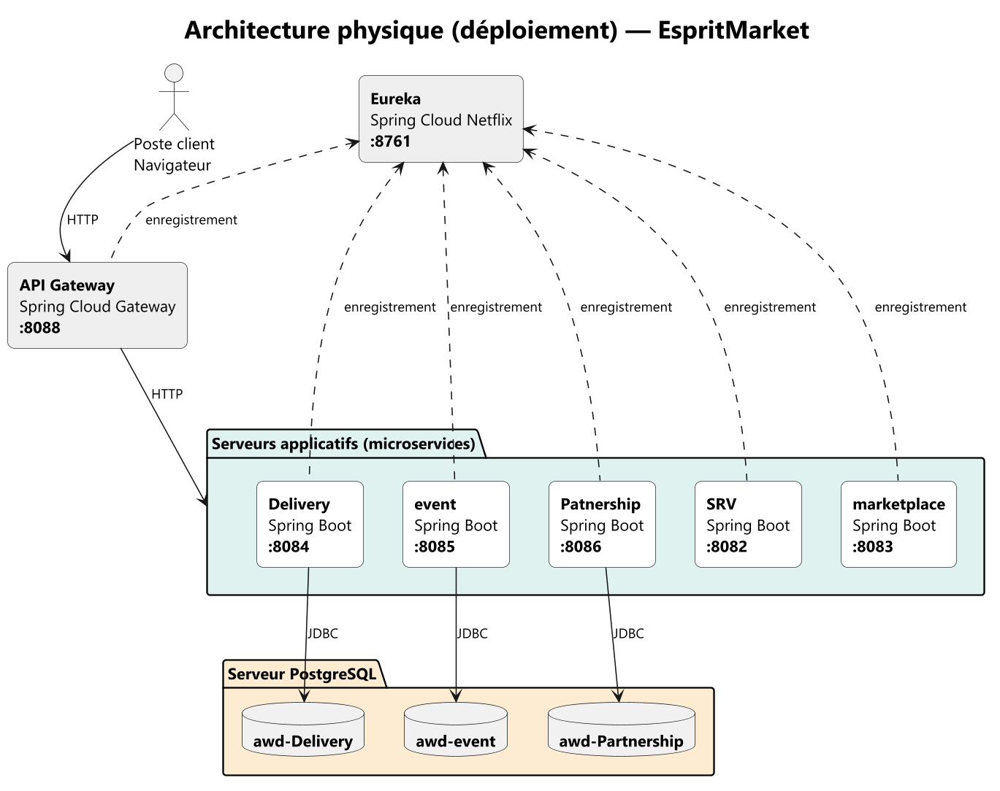

# EspritMarket – Microservices

**Projet : PIDEV 4SE1 (2025–2026)** — ESPRIT
Structure basée sur les workshops **Applications Web Distribuées (AWD)**

---

## Présentation du projet

**EspritMarket** est une place de marché de services dédiée à la communauté ESPRIT.
Les étudiants peuvent y proposer, découvrir et réserver des services entre pairs :

- **SRV** — offres de services : publication, réservation (booking), suivi des
  réalisations et livraison des livrables ; c'est le module en cours de développement
- **Marketplace, événementiel, partenariats** — autres domaines du projet

L'ensemble est construit en **architecture microservices** : chaque domaine est un
service Spring Boot indépendant, enregistré dans un registre **Eureka**.

---

## Architecture

### Architecture logique

Découpage en services, responsabilités de chaque service, base dédiée et enregistrement dans Eureka.



### Architecture physique (déploiement)

Poste client, serveurs applicatifs avec leurs ports, serveur PostgreSQL et protocoles échangés.



> Sources PlantUML : [`documentation/diag/`](documentation/diag/)

| Service | Dossier | Port | Rôle |
|---------|---------|------|------|
| discovery | `backend/discovery/` | 8761 | Eureka Server — registre de services |
| SRV | `backend/microservices/SRV/` | 8082 | Microservice services/réservations, client Eureka |
| marketplace | `backend/microservices/marketplace/` | 8083 | Microservice marketplace, client Eureka |
| Delivery | `backend/microservices/Delivery/` | 8084 | Microservice livraison (JPA + PostgreSQL), client Eureka |
| event | `backend/microservices/Event/` | 8085 | Microservice événementiel (JPA + PostgreSQL), client Eureka |
| Patnership | `backend/microservices/Partnership/` | 8086 | Microservice partenariats (JPA + PostgreSQL), client Eureka |
| User | `backend/microservices/User/` | 8087 | Microservice utilisateurs securise par Keycloak (OAuth2/JWT), client Eureka |
| Notification | `backend/microservices/Notification/` | 8090 | Microservice notifications (Python/FastAPI), integration Eureka, consommateur RabbitMQ (envoi email/SMTP ou log) |
| gateway | `backend/gateway/` | 8088 | Point d'entrée unique — routage dynamique `lb://` via Eureka, CORS |

---

## Technologies utilisées

- Java 17
- Spring Boot
- Spring Cloud Netflix Eureka (server + client)
- Maven
- IntelliJ IDEA

---

## Démarrage

**Ordre important :** toujours démarrer le serveur Eureka avant les microservices.

Prérequis local : PostgreSQL sur `localhost:5432` (utilisateur `postgres`,
mot de passe surchargé par `SPRING_DATASOURCE_PASSWORD` — par défaut `admin`),
avec les bases par service : `awd-Delivery`, `awd-event`, `awd-Partnership`.

```powershell
# Terminal 1 — Eureka Server sur :8761
cd backend/discovery
.\mvnw.cmd spring-boot:run

# Terminal 2 — SRV sur :8082
cd backend\microservices\SRV
.\mvnw.cmd spring-boot:run

# Terminal 3 — marketplace sur :8083
cd backend\microservices\marketplace
.\mvnw.cmd spring-boot:run

# Terminal 4 — Delivery sur :8084
cd backend\microservices\Delivery
.\mvnw.cmd spring-boot:run

# Terminal 5 — event sur :8085
cd backend\microservices\Event
.\mvnw.cmd spring-boot:run

# Terminal 6 — Patnership sur :8086
cd backend\microservices\Partnership
.\mvnw.cmd spring-boot:run

# Terminal 7 — User sur :8087 (Keycloak requis sur :8080)
cd backend\microservices\User
.\mvnw.cmd spring-boot:run

# Terminal 8 — Notification (Python) sur :8090
cd backend\microservices\Notification
pip install -r requirements.txt
python app.py

# Terminal 9 — API Gateway sur :8088
cd backend\gateway
.\mvnw.cmd spring-boot:run
```

Vérification : ouvrir <http://localhost:8761> → `GATEWAY` et les services (`SRV`,
`marketplace`, `Delivery`, `event`, `Patnership`) doivent apparaître dans
*Instances currently registered with Eureka*.

Le point d'entrée unique est la gateway sur <http://localhost:8088> :
`/srv/**`, `/marketplace/**`, `/delivery/**`, `/event/**` et `/patnership/**`
sont transformés en appels `lb://` vers les services (load balancing via Eureka).
